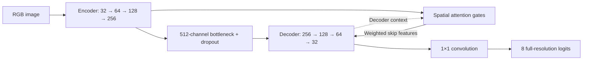

# Urban Scene Segmentation

A PyTorch project for category-level semantic segmentation of street scenes. It includes a normalized U-Net baseline, residual and attention variants, reproducible experiments, dataset-level segmentation metrics, and image prediction tools.

**Status:** the CPU training/evaluation/inference workflow is tested on generated fixtures. No real-data accuracy improvement is claimed yet. The original dataset archive and trained weights were not committed; see [data setup](docs/data.md). This is a portfolio and experimentation project, not a deployed driving system.

## Architecture

All variants use a five-level encoder/decoder by default, GroupNorm, ReLU, a dropout bottleneck, bilinear upsampling with channel projection, and a 1×1 prediction head. They return raw logits at the input resolution, including odd image dimensions.

| Variant | Residual blocks | Attention on skips | Parameters¹ |
| --- | --- | --- | ---: |
| `unet` | No | No | 7,240,552 |
| `residual_unet` | Yes | No | 7,588,808 |
| `attention_unet` | No | Yes | 7,328,316 |
| `residual_attention_unet` | Yes | Yes | 7,676,572 |

¹ Measured with RGB input, eight outputs, base width 32, and depth 4. Run `python network.py` to reproduce. The baseline is a modernized U-Net, not a bit-for-bit reproduction of the original paper or this repository's old model.



Residual connections provide a short gradient path within convolution blocks. Attention gates condition skip features on decoder context. GroupNorm avoids dependence on batch statistics when segmentation batches are small. Exact-size interpolation handles input dimensions that are not divisible by 16. These are design choices to test with ablations, not evidence of better accuracy.

## Install

Use Python 3.11 or newer. The CI workflow targets Python 3.11 and 3.12.

```bash
python3.11 -m venv .venv
source .venv/bin/activate
python -m pip install --upgrade pip
# CPU setup; for CUDA, install the wheel appropriate to your hardware instead.
python -m pip install torch --index-url https://download.pytorch.org/whl/cpu
python -m pip install -e '.[dev,plots]'
```

Runtime dependencies are PyTorch, NumPy, and Pillow. Plotting and development tools are optional. There is no required MLflow account, DagsHub connection, Graphviz installation, or pretrained-weight download.

## Run a CPU smoke experiment

This creates **synthetic fixtures**, trains a tiny model for two epochs, evaluates its saved validation split, and writes predictions. Use fresh output directories when repeating it.

```bash
python scripts/make_demo_data.py data/demo
OMP_NUM_THREADS=1 python training.py data/demo --config configs/smoke.json --output runs/smoke --device cpu
OMP_NUM_THREADS=1 python evaluate.py data/demo runs/smoke/best.pt --output runs/smoke/evaluation.json --device cpu
OMP_NUM_THREADS=1 python inference.py data/demo/img/val runs/smoke/best.pt --output runs/smoke/predictions --device cpu
python scripts/plot_history.py runs/smoke
pytest -q
```

Synthetic scores establish that the pipeline runs; they do not measure street-scene generalization. `OMP_NUM_THREADS=1` avoids excessive threading overhead for this tiny CPU example.

## Train with real data

[Data setup](docs/data.md) explains both the original eight-color dataset layout and official Cityscapes files. For the latter, extract image and annotation archives to the same root:

```text
data/cityscapes/
├── leftImg8bit/
│   ├── train/<city>/*_leftImg8bit.png
│   └── val/<city>/*_leftImg8bit.png
└── gtFine/
    ├── train/<city>/*_gtFine_labelIds.png
    └── val/<city>/*_gtFine_labelIds.png
```

```bash
python training.py data/cityscapes --config configs/cityscapes.json --output runs/cityscapes --device auto --workers 2
# Continue an interrupted run using the original configuration and epoch budget:
python training.py data/cityscapes --resume runs/cityscapes/last.pt --output runs/cityscapes --device auto --workers 2
```

For the project's simplified RGB palette, use `configs/baseline.json` and `configs/attention.json`. Config files override defaults in `config.py`. The official-data config changes the mask encoding to `cityscapes_ids`; use that encoding for *both* models in a comparison.

Training uses AdamW, cosine learning-rate decay, cross entropy plus soft Dice, gradient clipping, optional CUDA mixed precision, and early stopping. `best.pt` tracks the highest validation mIoU. `last.pt` stores the latest completed epoch. A fresh run cannot overwrite an existing run directory.

Predefined train/validation folders take priority. Without them, the split groups Cityscapes-style sequence names together; otherwise it groups by relative directory. At least two groups are required. Exact duplicate image files across training and validation are rejected. This does not detect all near-duplicate scenes; review data provenance before reporting results.

## Evaluate and predict

```bash
# Re-evaluate the exact saved validation split, checking dataset contents:
python evaluate.py data/cityscapes runs/cityscapes/best.pt --output runs/cityscapes/evaluation.json
# Evaluate a separate labeled split, when one is available:
python evaluate.py data/cityscapes runs/cityscapes/best.pt --split holdout --output runs/cityscapes/holdout.json
# Predict a single image or directory; masks are not needed:
python inference.py path/to/photo.jpg runs/cityscapes/best.pt --output runs/cityscapes/predictions
```

Predictions include category-ID PNGs, palette-colored masks, and overlays at each source image's original size. Input subdirectories and extensions are retained in output names to avoid collisions. `segment-train`, `segment-evaluate`, and `segment-predict` are equivalent installed commands.

Evaluation uses the configured training resolution, normally 256×512. The report contains dataset-level mIoU, macro Dice, pixel accuracy, per-class support/scores, and a confusion matrix. Rows are true classes; columns are predictions. Classes absent from both truth and prediction are omitted from the macro mean and reported as `null`. False-positive-only classes contribute zero. Ignored pixels are excluded from all metrics.

The default output taxonomy is `void`, `flat`, `construction`, `object`, `nature`, `sky`, `human`, `vehicle`. Void targets are ignored by default. Original Cityscapes IDs are mapped to seven semantic categories, with officially ignored labels excluded. **These category-level, resized metrics are not the official 19-class Cityscapes benchmark.**

## Experiment artifacts

Each run contains:

- `config.json`, `environment.json`: resolved settings, library versions, device, Git revision and dirty status.
- `splits.json`: sample keys, sequence groups, and image/mask SHA-256 hashes.
- `history.json`, `history.csv`: epoch losses, metrics, learning rate, and elapsed time.
- `best.pt`, `last.pt`: model, optimizer, scheduler, scaler, and progress state; loaded with `weights_only=True`.
- `best_metrics.json`: validation metrics at the selected checkpoint.
- `learning_curves.png`: generated by the optional plotting command.

Epoch-derived random seeds cover initialization, shuffling, augmentation, dropout, and worker seeds. Resume requires the same configuration, data, device and worker count. CPU tests compare resumed and uninterrupted weights exactly. Reproducibility across different library versions or hardware is not guaranteed; CUDA/AMP still needs a hardware validation run.

## Portfolio evidence

See [the experiment protocol](docs/experiments.md) for a fair comparison and CV wording. Publish measured results, qualitative examples, and failure cases after training on real data. Do not present the synthetic fixture metrics as model quality.

The tests cover shape preservation and gradients across all four variants, tiny-batch overfitting, label mapping, ignored pixels, split leakage checks, hand-computed IoU/Dice cases, checkpoint selection, exact CPU resume, evaluation, and unlabeled inference. GitHub Actions runs tests, lint, and formatting checks.

```bash
ruff check .
ruff format --check .
pytest -q
```

## References

- [U-Net — Ronneberger et al.](https://arxiv.org/abs/1505.04597)
- [Attention U-Net — Oktay et al.](https://arxiv.org/abs/1804.03999)
- [Official Cityscapes label definitions](https://github.com/mcordts/cityscapesScripts/blob/master/cityscapesscripts/helpers/labels.py)
- [PyTorch checkpoint serialization](https://docs.pytorch.org/docs/stable/notes/serialization.html)

The implementation combines these ideas for this project's category task; it does not claim a novel architecture. Earlier whole-object checkpoints and the old pandas/Albumentations dataset API are not compatible with this version. The positional training and inference script entry points are retained.
